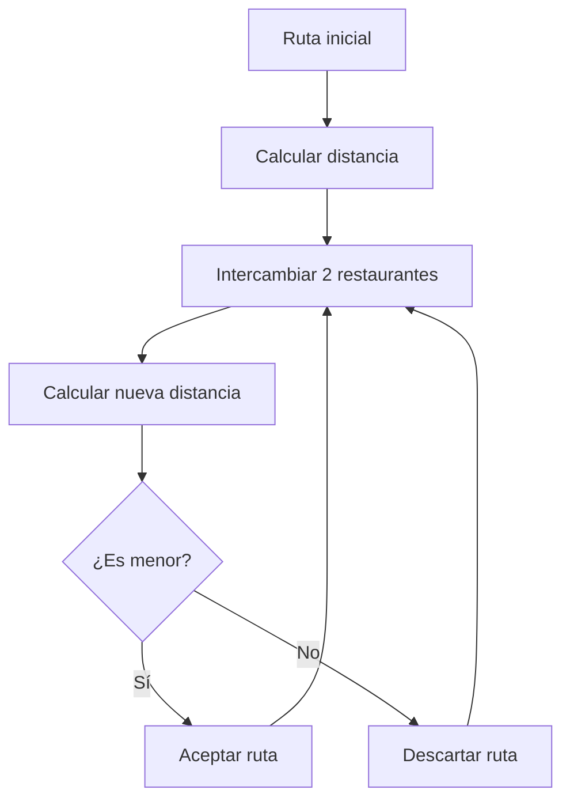
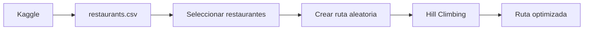

# Optimización de Rutas con Hill Climbing

Proyecto sencillo de **Inteligencia Artificial** para optimizar una ruta entre restaurantes reales usando **Hill Climbing**.

Los datos se descargan desde Kaggle y se utilizan las coordenadas geográficas de los restaurantes para calcular las distancias.

## Objetivo

Seleccionar varios restaurantes de una misma zona y encontrar una ruta que permita visitarlos recorriendo la menor distancia posible.

```text
Ruta inicial
0 → 8 → 4 → 12 → 1 → 7 → 3

Distancia: 31.47 km

        ↓ Hill Climbing

Ruta optimizada
0 → 3 → 7 → 1 → 4 → 8 → 12

Distancia: 18.25 km
```

La función objetivo es:

```text
MINIMIZAR la distancia total de la ruta
```

## Dataset

Se utiliza el dataset:

**Uber Eats USA Restaurants and Menus**

Kaggle:

```text
ahmedshahriarsakib/uber-eats-usa-restaurants-menus
```

El dataset incluye dos archivos:

```text
restaurant-menus.csv
restaurants.csv
```

Para este proyecto solamente utilizamos:

```text
restaurants.csv
```

Las columnas principales son:

```text
id
name
full_address
zip_code
lat
lng
```

## ¿Cómo funciona Hill Climbing?

Primero se crea una ruta aleatoria.

```text
0 → 4 → 7 → 2 → 8 → 1
```

Después se crea una ruta vecina intercambiando dos restaurantes.

```text
0 → 4 → 8 → 2 → 7 → 1
```

Se calcula la distancia de ambas rutas.

```text
Ruta actual:  24.8 km
Ruta vecina:  21.3 km
```

Si la nueva ruta es mejor:

```text
21.3 < 24.8
```

se acepta.

El proceso se repite varias veces.



## Estructura

```text
ruta-real/
│
├── main.py
├── restaurant_data.py
├── route_optimizer.py
├── pyproject.toml
└── uv.lock
```

### `restaurant_data.py`

Se encarga de:

- descargar el dataset;
- cargar `restaurants.csv`;
- seleccionar restaurantes de una misma zona;
- entregar los datos que utilizará el optimizador.

### `route_optimizer.py`

Se encarga de:

- calcular distancias;
- crear una ruta inicial;
- generar rutas vecinas;
- ejecutar Hill Climbing.

### `main.py`

Coordina todo el programa y muestra los resultados en consola.

## Instalación

Crear el proyecto:

```bash
uv init ruta-real
cd ruta-real
```

Instalar dependencias:

```bash
uv add kagglehub pandas rich
```

## Ejecución

```bash
uv run main.py
```

La primera ejecución descargará automáticamente el dataset de Kaggle.

## Flujo del programa



## Conceptos de IA utilizados

| Concepto | Aplicación |
|---|---|
| Solución | Una ruta |
| Función objetivo | Distancia total |
| Objetivo | Minimizar kilómetros |
| Vecino | Ruta con dos posiciones intercambiadas |
| Algoritmo | Hill Climbing |
| Mejora | Una ruta con menor distancia |

## Distancia entre restaurantes

Para calcular la distancia entre dos coordenadas se utiliza la **fórmula de Haversine**.

El dataset proporciona:

```text
lat → latitud
lng → longitud
```

La distancia se calcula en kilómetros.

## Idea principal

Hill Climbing sigue una lógica sencilla:

```text
CREAR SOLUCIÓN
      ↓
EVALUAR
      ↓
CREAR VECINO
      ↓
¿ES MEJOR?
   ↙       ↘
 SÍ         NO
 ↓           ↓
ACEPTAR    DESCARTAR
   ↘       ↙
     REPETIR
```

Hill Climbing no garantiza encontrar siempre la mejor ruta posible, pero permite encontrar soluciones mejores mediante cambios progresivos.
